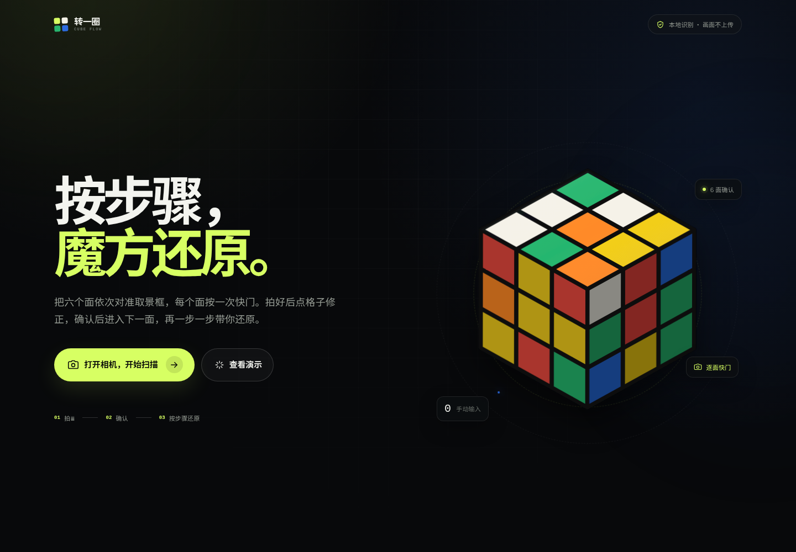
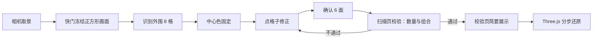
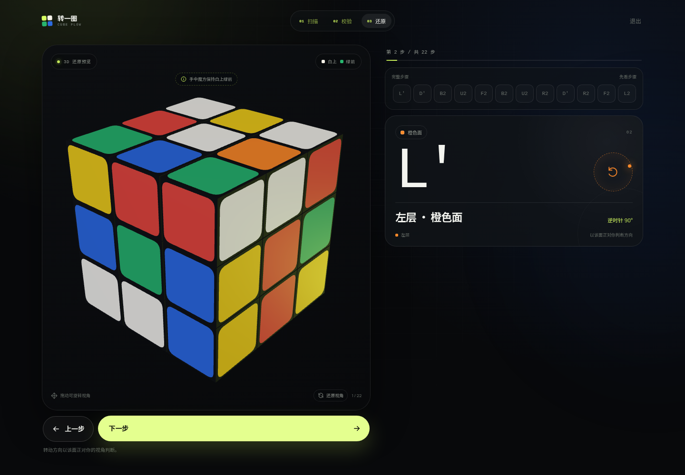

# 转一圈 · Cube Flow

<p align="center">
  
</p>

把魔方六个面各拍一张，在冻结照片上点格子校正颜色，确认后由浏览器本地求解，再用 3D 分步指导还原。

纯前端应用，无后端、无账号、画面不上传。

## 核心体验

- **一面一次快门**：实时取景只负责对位，按一次快门拍下一面，六面共六次。
- **中心色固定**：每个面的中心色由目标面直接确定，中心格锁定，识别范围收敛到外围 8 格。
- **冻结照片校色**：快门后保留裁切后的正方形画面，3×3 色块与照片严格对齐；点任意外围格子循环切换颜色。
- **软提示不阻断**：中心色看起来偏另一面时给出黄色提示，用户仍可继续确认或重拍。
- **缺失格可补**：某个格子没识别到时会标记为 `?`，手动点选补色后即可确认。
- **六面统一校验**：全部确认后检查每种颜色是否固定 9 块，数量不对时回到对应面修正。
- **本地求解与 3D 指导**：求解器在 Web Worker 中运行，Three.js 按步骤演示每一次转动。
- **隐私优先**：识别、校验、求解全部在浏览器本地完成，没有图片上传接口。

## 使用流程

1. 打开相机，按提示依次拍摄 **绿、红、蓝、橙、白、黄** 六个面。
2. 每次快门后核对冻结照片；点外围色块修正识别结果，中心格保持锁定。
3. 点「确认这一面」，进入下一面；六面确认完成后先在扫描页校验颜色数量和组合。
4. 校验不通过时留在扫描页，提示有问题的颜色，并高亮可能要修改的面；点进度格中的面即可打开照片修正。
5. 校验通过后短暂展示校验页，再进入 3D 分步还原。
6. 校验页仍保留单面重拍和重新扫描入口，作为后续修正的备用路径。

电脑端用于浏览和演示。点击「打开相机，开始扫描」会显示当前访问地址的二维码，用手机扫描打开后继续扫描和还原。



## 拍摄与识别策略

### 固定中心色

以白色为上层、绿色为前层，按以下顺序拍摄：

| 顺序 | 面 | 中心色 | 对准方式 |
| --- | --- | --- | --- |
| 1 | 前 F | 绿 | 白色中心朝上，绿色面对准取景框 |
| 2 | 右 R | 红 | 保持白色朝上，红色面对准取景框 |
| 3 | 后 B | 蓝 | 保持白色朝上，蓝色面对准取景框 |
| 4 | 左 L | 橙 | 保持白色朝上，橙色面对准取景框 |
| 5 | 上 U | 白 | 白色面对准取景框，绿色边朝下 |
| 6 | 下 D | 黄 | 黄色面对准取景框，绿色边朝上 |

中心色直接采用目标面的固定值。快门只为外围 8 格提供颜色建议，中心格不参与面判定，也不会被识别结果覆盖。

### 识别只提供建议

颜色分类负责给出初始值，最终结果由用户确认：

- 九个格子按取景框裁切后精确采样，减少透视和边缘干扰。
- 一次快门连续采样多帧，优先选择外围格子更完整、整体置信度更高的一帧。
- 低置信度或未分类格子显示为 `?`，由用户点选补色。
- 中心像素仅用于生成不阻断的偏色提示；提示不会禁用确认按钮。

### 校验时机

单面拍摄阶段只检查画面是否可用，识别异常交给冻结照片校正。六面全部确认后再统一检查：

- 每种颜色恰好 9 块。
- 六个中心色唯一。
- 由求解器校验角块、棱块组合是否合法。

## 技术栈

| 模块 | 实现 |
| --- | --- |
| 应用框架 | Vite 8 + 原生 JavaScript |
| 相机与采样 | `getUserMedia` + Canvas 2D |
| 颜色识别 | HSV 分类 + 中值采样 + 置信度 |
| 求解器 | cubejs，本地化到 `src/vendor/cubejs`，运行在 Web Worker |
| 3D 指导 | Three.js，按需动态加载 |
| 字体 | Manrope、Noto Sans SC 子集（SIL OFL） |

## 本地运行

要求 Node.js 20.19+ 或 22.12+。

```bash
npm install
npm run dev
```

开发服务器默认运行在 `http://localhost:5173`。

生产构建与预览：

```bash
npm run build
npm run preview
```

预览默认运行在 `http://localhost:4173`。相机能力要求 `localhost` 或 HTTPS 环境。

## 目录结构

```text
.
├── index.html
├── package.json
├── vite.config.js
├── public/
│   ├── favicon.svg
│   └── licenses/
├── src/
│   ├── main.js                 # 四屏流程、扫描确认、校验与还原交互
│   ├── style.css               # 全站样式与响应式布局
│   ├── assets/                 # 字体子集
│   ├── lib/
│   │   ├── colors.js           # 颜色、面与网格工具
│   │   ├── color-vision.js     # HSV 分类与中值采样
│   │   ├── face-scanner.js     # 相机取景、正方形裁切、快照与照片捕获
│   │   ├── solver-client.js    # 求解 Worker 封装
│   │   ├── cube-view.js        # Three.js 立方体与步骤动画
│   │   └── icons.js            # 内联图标
│   ├── worker/
│   │   └── solver-worker.js    # 消歧、合法性校验与求解
│   └── vendor/
│       └── cubejs/             # 本地化求解库与许可证
└── docs/
    ├── landing.png
    ├── guide.png
    └── solved.png
```

## 3D 还原指导

<p align="center">
  
</p>

每一步都会显示转动面、方向、角度和完整步骤序列，左侧立方体同步演示。上一步和下一步放在立方体下方，手机上也能在第一屏直接操作；拖动旋转后可以一键还原视角。

## 隐私与数据

- 相机画面只存在于当前页面的 Canvas 和内存中。
- 颜色识别、求解、3D 渲染全部在本地浏览器完成。
- 没有后端接口、账号系统、统计脚本或图片上传。
- 刷新或关闭页面后，本次扫描数据不会保留。

## 第三方资源

- [cubejs](https://github.com/ldez/cubejs)：MIT License，见 `src/vendor/cubejs/LICENSE`。
- [qrcode](https://github.com/soldair/node-qrcode)：MIT License，用于生成当前页面的手机接力二维码。
- Manrope、Noto Sans SC：SIL Open Font License 1.1，见 `public/licenses/`。

## 已知限制

- 反光、强光、过暗或背景杂乱会影响颜色分类，拍摄前请保持光线均匀。
- 魔方需要完整落在取景框内；格子缺失时可在冻结照片上手动补色。
- 移动端建议使用系统浏览器，并允许相机权限。
- 求解耗时与打乱程度有关，复杂状态可能需要几秒。
