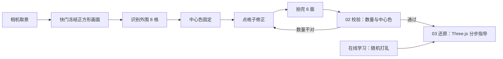

# 拍魔方 · CubScan

<p>
  
  
  
  
  
</p>

<p align="center">
  
</p>

用手机把魔方六个面各拍一张，在冻结照片上点格子校正颜色，交给浏览器本地校验和求解，再跟着 3D 分步指导把魔方还原。

纯前端应用，无后端、无账号、画面不上传。既可以在浏览器里直接用，也可以用 Capacitor 打成安卓 App 装在手机上。

> 适合谁：手上有个打乱的魔方但不想背公式的人；想边看 3D 演示边学还原的人；想研究「相机采样 + 颜色分类 + 本地求解」这条链路怎么做的开发者。

## 双端结构

| 入口 | 页面 | 承载内容 |
| --- | --- | --- |
| 手机端 | `index.html` | 完整流程：扫描 → 校验 → 3D 还原，另有在线学习模式 |
| 电脑端 | `desktop.html` | 独立落地页：左侧文案与二维码，右侧只有可交互的魔方展示 |

- 电脑端不运行还原逻辑，只负责介绍和扫码接力；手机扫码后接管全部流程。
- `index.html` 检测到精细指针（鼠标）且视口宽度 ≥ 820px 时会自动跳转到 `desktop.html`，加 `?mobile=1` 可强制留在手机版。
- 桌面页魔方可拖动旋转、滚轮缩放（0.7–1.7 倍），缩放基于 CSS 变换，不会裁掉画布。

## 核心体验

- **一面一次快门**：实时取景只负责对位，按一次快门拍下一面，六面共六次。
- **中心色固定**：每个面的中心色由目标面直接确定，中心格锁定，识别范围收敛到外围 8 格，校验页也不能修改中心色。
- **冻结照片校色**：快门后保留裁切后的正方形画面，3×3 色块与照片严格对齐；点任意外围格子循环切换颜色。
- **软提示不阻断**：颜色识别只给建议，不因为置信度低而中断拍摄；异常以色块 `?` 或文字提示呈现。
- **缺失格可补**：某个格子没识别到时会标记为 `?`，手动点选补色后即可确认。
- **三步式校验**：顶部 01 扫描 / 02 校验 / 03 还原 三个标签可回看，但必须当前步骤通过才能进入下一步。
- **数量提示而非阻断**：校验页逐色显示 `n/9`，数量不对时只用文字提示「颜色数量不对，请核对」，由用户自行修正。
- **本地求解与 3D 指导**：求解器在 Web Worker 中运行，Three.js 按步骤演示每一次转动。
- **在线学习**：没有实体魔方时随机打乱一个虚拟魔方，用同一套 3D 指导学习每一步。
- **隐私优先**：识别、校验、求解全部在浏览器本地完成，没有图片上传接口。

## 使用流程

1. 打开相机，按提示依次拍摄 **绿、红、蓝、橙、白、黄** 六个面。
2. 每次快门后核对冻结照片；点外围色块修正识别结果，中心格保持锁定。
3. 六面拍完进入 **02 校验**：页面展示每种颜色的数量和中心色唯一性，数量不对时给出文字提示；可通过单面重拍或点格子直接修正。
4. 校验通过后进入 **03 还原**：3D 魔方逐步演示转动，可拖动查看视角。
5. 没有魔方时点「在线学习」，随机打乱生成演示状态，直接体验还原教学。



## 拍摄与识别策略

### 固定中心色

以白色为上层、绿色为前层，按以下顺序拍摄：

| 顺序 | 面 | 中心色 | 对准方式 |
| --- | --- | --- | --- |
| 1 | 前 F | 绿 | 白色中心朝上，绿色面对准取景框 |
| 2 | 右 R | 红 | 保持白色朝上，红色面对准取景框 |
| 3 | 后 B | 蓝 | 保持白色朝上，蓝色面对准取景框 |
| 4 | 左 L | 橙 | 保持白色朝上，橙色面对准取景框 |
| 5 | 上 U | 白 | 白色面对准取景框，绿色边朝下 |
| 6 | 下 D | 黄 | 黄色面对准取景框，绿色边朝上 |

中心色直接采用目标面的固定值。快门只为外围 8 格提供颜色建议，中心格不参与面判定，也不会被识别结果覆盖。

### 识别只提供建议

颜色分类负责给出初始值，最终结果由用户确认：

- 九个格子按取景框裁切后精确采样，减少透视和边缘干扰。
- 一次快门连续采样多帧，优先选择外围格子更完整、整体置信度更高的一帧。
- 低置信度或未分类格子显示为 `?`，由用户点选补色。
- 中心像素仅用于生成不阻断的偏色提示；提示不会禁用确认按钮。

### 校验时机

一扫完就进入校验页，不做自动错误拦截：

- 每种颜色是否恰好 9 块，逐色显示计数。
- 六个中心色是否唯一。
- 数量不对时只输出文字提示，不锁定操作；用户修正后由求解器校验角块、棱块组合是否合法。

## 技术栈

| 模块 | 实现 |
| --- | --- |
| 应用框架 | Vite 8 + 原生 JavaScript，双入口（`index` / `desktop`） |
| 相机与采样 | `getUserMedia` + Canvas 2D |
| 颜色识别 | HSV 分类 + 中值采样 + 置信度 |
| 求解器 | cubejs，本地化到 `src/vendor/cubejs`，运行在 Web Worker |
| 3D 指导 | Three.js，按需动态加载 |
| 手机接力 | qrcode 生成当前访问地址的二维码 |
| 字体 | Manrope、Noto Sans SC 子集（SIL OFL） |

## 本地运行

要求 Node.js 20.19+ 或 22.12+。

```bash
npm install
npm run dev
```

开发服务器默认运行在 `http://localhost:5173`，并监听局域网地址。

手机真机调试相机时，浏览器要求 HTTPS，可用自签证书启动：

```bash
npm run dev:https
```

手机在同一个 Wi-Fi 下打开终端输出的局域网 `https://` 地址，接受证书警告后即可使用相机。

生产构建与预览：

```bash
npm run build
npm run preview
```

预览默认运行在 `http://localhost:4173`。

## 打包成安卓 App

项目用 [Capacitor](https://capacitorjs.com/) 8 把同一份前端产物装进 Android WebView，页面、识别和求解逻辑完全复用，没有第二套实现。

### 环境要求

- Node.js 20.19+（或 22.12+）
- JDK 17+
- Android SDK（Platform 36 / Build-Tools 35 会自动补齐），并配置 `ANDROID_HOME` 或 `android/local.properties`

### 构建步骤

```bash
npm install
npm run build          # 产出 dist/
npx cap sync android   # 同步 dist 到 android/app/src/main/assets/public
cd android
./gradlew assembleDebug   # Windows: .\gradlew.bat assembleDebug
```

产物在 `android/app/build/outputs/apk/debug/app-debug.apk`，直接传到手机安装即可（首次安装需允许「安装未知来源应用」）。

上架或分发给他人时，请在 `android/app/build.gradle` 里配置自己的 `signingConfigs`，再用 `assembleRelease` 出签名包；仓库里不带任何密钥。

### 壳层做了哪些适配

| 问题 | 处理 |
| --- | --- |
| 相机权限 | `AndroidManifest.xml` 声明 `CAMERA`，WebView 内 `getUserMedia` 走系统授权弹窗 |
| 安全上下文 | `capacitor.config.json` 设置 `androidScheme: 'https'`，否则 `getUserMedia` 会被判定为非安全上下文 |
| WebGL 黑屏 | Manifest 开启 `hardwareAccelerated`，`MainActivity` 显式设置 `LAYER_TYPE_HARDWARE`；渲染器按「抗锯齿 → 关抗锯齿 → low-power」逐级降级 |
| 旧版 WebView | 构建目标锁定 `es2019/chrome80`；`index.html` 内联补齐 `FinalizationRegistry`、`WeakRef`，避免旧 WebView 里 three.js 初始化报错 |
| 图标与启动屏 | 图标直接用 `public/favicon.png` 原图（透明背景），启动屏为白底居中 `layer-list`，不拉伸变形 |

## 目录结构

```text
.
├── index.html                  # 手机端入口，桌面宽度自动跳转 desktop.html
├── desktop.html                # 电脑端独立落地页
├── package.json
├── vite.config.js              # 双入口构建 + 可选 HTTPS
├── capacitor.config.json       # 安卓壳配置（appId / webDir / androidScheme）
├── public/
│   └── favicon.png
├── src/
│   ├── main.js                 # 手机端四屏流程、扫描确认、校验与还原交互
│   ├── style.css               # 手机端样式与响应式布局
│   ├── desktop-main.js         # 桌面落地页：魔方展示与二维码
│   ├── desktop.css             # 桌面落地页样式
│   ├── assets/                 # 字体子集
│   ├── lib/
│   │   ├── colors.js           # 颜色、面与网格工具
│   │   ├── color-vision.js     # HSV 分类与中值采样
│   │   ├── face-scanner.js     # 相机取景、正方形裁切、快照与照片捕获
│   │   ├── solver-client.js    # 求解 Worker 封装
│   │   ├── cube-view.js        # Three.js 立方体、步骤动画、拖动与缩放
│   │   └── icons.js            # 内联图标
│   ├── worker/
│   │   └── solver-worker.js    # 消歧、合法性校验与求解
│   └── vendor/
│       └── cubejs/             # 本地化求解库与许可证
├── android/                    # Capacitor 生成的安卓工程（可自行改包名/签名）
└── docs/
    ├── landing.png
    ├── guide.png
    └── solved.png
```

## 3D 还原指导

<p align="center">
  
</p>

每一步都会显示转动面、方向、角度和完整步骤序列，左侧立方体同步演示。上一步和下一步放在立方体下方，手机上也能在第一屏直接操作；拖动旋转后可以一键还原视角。

## 隐私与数据

- 相机画面只存在于当前页面的 Canvas 和内存中。
- 颜色识别、求解、3D 渲染全部在本地浏览器完成。
- 没有后端接口、账号系统、统计脚本或图片上传。
- 刷新或关闭页面后，本次扫描数据不会保留。

## 第三方资源

- [cubejs](https://github.com/ldez/cubejs)：MIT License，见 `src/vendor/cubejs/LICENSE`。
- [qrcode](https://github.com/soldair/node-qrcode)：MIT License，用于电脑端生成手机接力二维码。
- Manrope、Noto Sans SC：SIL Open Font License 1.1。

## 已知限制

- 反光、强光、过暗或背景杂乱会影响颜色分类，拍摄前请保持光线均匀。
- 魔方需要完整落在取景框内；格子缺失时可在冻结照片上手动补色。
- 手机端建议使用系统浏览器，并允许相机权限；`http://` 局域网地址无法启用相机，请用 `npm run dev:https`。
- 求解耗时与打乱程度有关，复杂状态可能需要几秒。

## 兼容性

- 浏览器：Chrome / Edge 80+、Safari 14+、Android WebView（Chrome 80 及以上）。
- 安卓壳：Android 7.0 及以上；如果系统 WebView 过旧，建议先在应用商店更新「Android System WebView」。
- 相机需要安全上下文（HTTPS 或 `file`/`https` 壳环境），这也是安卓壳里使用 `androidScheme: 'https'` 的原因。

## 贡献

欢迎提 Issue 和 PR：

1. Fork 本仓库并从 `main` 切出特性分支。
2. 提交前请确认 `npm run build` 可通过，并尽量在真机上验证一次相机与 3D 流程。
3. PR 描述里写清楚动机、改动范围和验证方式（截图/录屏更好）。

代码风格保持现状：原生 JavaScript、无框架、无额外运行时依赖。

## 许可证

[MIT](LICENSE) © 2026 wenlibo90
